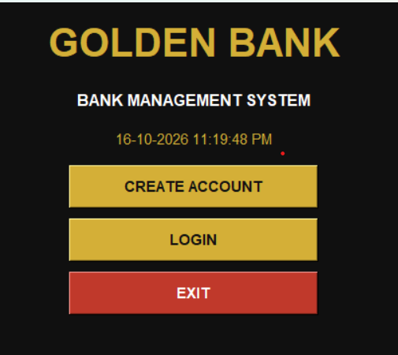
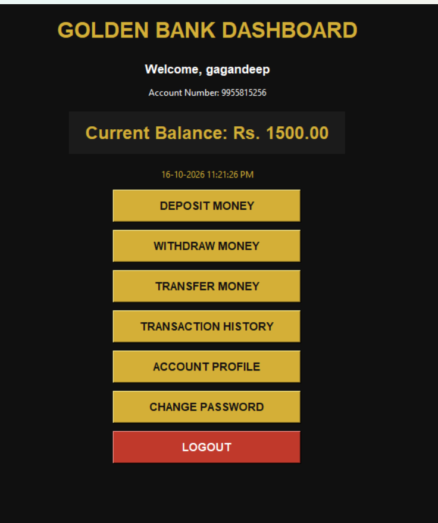
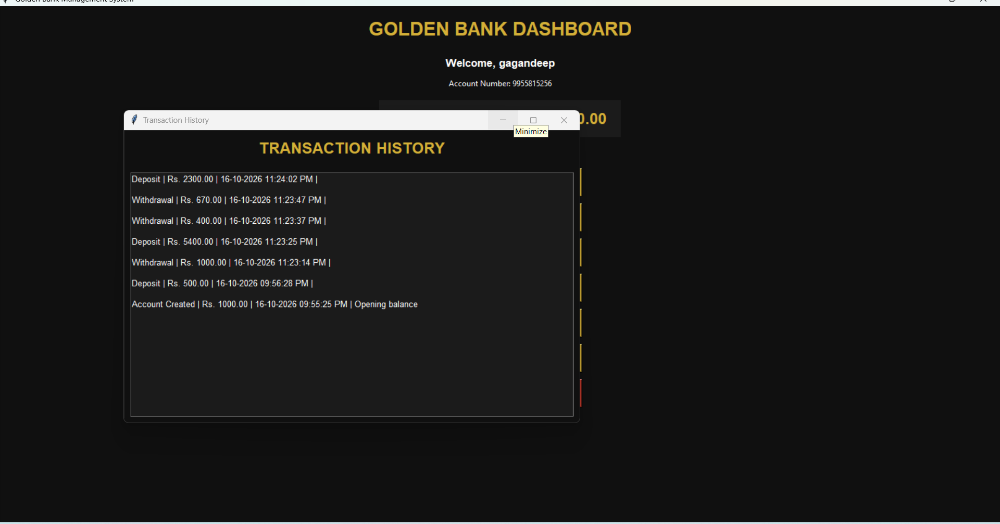

# 🏦 Golden Bank Management System

A Python-based Bank Management System developed using Tkinter.

## 📌 About the Project
Golden Bank Management System is a desktop application
designed to demonstrate basic banking operations.

## ✨ Features
- Create a new bank account
- Login system
- Check account balance
- Deposit money
- Withdraw money
- Transfer money between accounts
- View transaction history
- View account profile
- Change password
- Transaction receipts with date and time
- Save account data locally

## 🛠️ Technologies Used
- Python
- Tkinter
- JSON
- SHA-256 password hashing

## ▶️ How to Run
1. Install Python.
2. Download the project Python file.
3. Open the file using Python IDLE.
4. Select Run → Run Module.

## 🎓 Project Purpose
This project was created for learning Python programming,
GUI development, and basic banking system operations.

## 👨‍💻 Developer
Student Project
## 📸 Project Screenshots

### 1. Welcome Screen

### 2. Bank Dashboard

### 3. Transaction History

